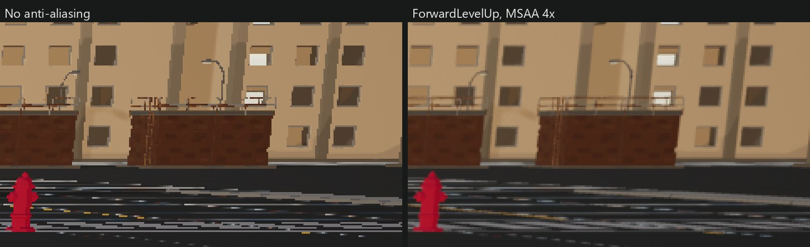

# ForwardLevelUp

Clean MSAA and proper ambient occlusion for Unreal Engine 5.8's mobile forward renderer, on PC and mobile hardware. Engine patches for a source build; everything is off until you turn it on.



**[Before and after comparisons and gameplay videos](https://vaei.github.io/ForwardLevelUp/)**

What you get:

- Smoother MSAA edges, without shadow and AO halos around them.
- Ambient occlusion that works in forward: screen-space, distance-field, character contact shadows and street-scale occlusion from buildings.
- Screen-space reflections under MSAA without crashing.
- Optionally, world normals for post-process materials.

## Get it working

You need a UE 5.8 source build, and a project using the mobile renderer (`bPreferFeatureLevelES31` on PC, or a mobile platform).

1. Apply the patches to the engine, in order:

   ```
   cd "<Engine root>"
   git apply <this repo>/Patches/1-wide-resolve.patch
   git apply <this repo>/Patches/2-df-shadow-msaa-fix.patch
   git apply <this repo>/Patches/3-edge-aware-fetch-and-ao.patch
   git apply <this repo>/Patches/4-skip-redundant-resolve.patch
   git apply <this repo>/Patches/5-forward-dfao.patch
   git apply <this repo>/Patches/6-mobile-capsule-ao-and-ssr-fix.patch
   git apply <this repo>/Patches/7-forward-normal-target.patch
   git apply <this repo>/Patches/8-mobile-height-field-ao.patch
   ```

2. Build the editor. The first launch recompiles every material.
3. Add this to `Config/DefaultEngine.ini` under `[/Script/Engine.RendererSettings]`:

   ```ini
   ; Mobile forward. 5.8 defaults to mobile deferred, which cannot use MSAA.
   r.Mobile.ShadingPath=0
   r.Mobile.AntiAliasing=3
   r.MSAACount=4
   r.WideCustomResolve=2
   r.Mobile.MSAA.EdgeAwareFetch=1
   r.Mobile.MSAA.SkipRedundantResolve=1
   r.Mobile.AmbientOcclusion=1
   r.DefaultFeature.AmbientOcclusion=True
   ```

4. Restart the editor. Edges are smooth, and thin railings and poles stop shimmering.

### Optional extras

Each needs the setup above.

- **Distance-field AO:** `r.Mobile.DistanceFieldAO=1`. Needs `r.GenerateMeshDistanceFields=True` and a Movable sky light with Cast Shadows.
- **Contact shadows under characters:** `r.Mobile.EnableCapsuleShadows=1` and `r.CapsuleIndirectSkyLightFromAbove=1`, with distance-field AO on. On each character, tick Cast Capsule Indirect Shadow on the skeletal mesh component and set a Shadow Physics Asset on the skeletal mesh.
- **Screen-space reflections:** `r.Mobile.ScreenSpaceReflections=1`.
- **Occlusion from buildings:** `r.Mobile.HeightFieldAO=1`. Copy `Examples/HeightFieldAOCapture` into your game module, add `"Renderer"` to its dependencies, then place the actor and size its box over the level.
- **World normals in post-process materials:** `r.Mobile.Forward.NormalTarget=1`. SceneTexture WorldNormal then works in post-process materials.

## Troubleshoot

- **No anti-aliasing at all.** Check `r.Mobile.ShadingPath=0`. Under mobile deferred every MSAA setting is ignored.
- **AA settings from the console do nothing in the editor.** The mobile preview device profile overrides them. Set them in the ini and restart.
- **Ini settings ignored.** A `# comment` after a value becomes part of the value. Put comments on their own `;` line.
- **Point and spot lights went dark.** Forward needs `r.Mobile.Forward.EnableLocalLights=1`.
- **No AO.** `r.Mobile.AmbientOcclusion=1` and `r.DefaultFeature.AmbientOcclusion=True` (or a post-process volume with AO intensity above 0). Distance-field, capsule and height-field AO all draw into the SSAO texture, so they need it too.
- **Distance-field AO missing or too dark.** It needs mesh distance fields and a Movable sky light with Cast Shadows and no static lighting. Its strength comes from the sky light: lower Occlusion Max Distance or raise Min Occlusion.
- **No contact shadow under characters.** Check both character settings above. If the sky's brightest direction is near the horizon, `r.CapsuleIndirectSkyLightFromAbove=1` is what makes it show.
- **Height-field AO does nothing.** `ProfileGPU` shows `HeightFieldAO` when it runs. Check the capture actor's box covers the camera, and that SSAO is on.
- **Height-field AO darkens walls under roof overhangs.** Raise `r.Mobile.HeightFieldAO.NormalBias` past the overhang depth.
- **Post-process material fails with "GBuffer scene textures not available with forward shading".** Set `r.Mobile.Forward.NormalTarget=1` and restart. Only WorldNormal is supported. A warning for PCD3D_SM5 remains, which is harmless when you only preview mobile.
- **Unlit or translucent materials do not get the edge fixes or AO.** Only opaque and masked lit materials do.

## Tune it

| Setting | Default | What it does |
|---|---|---|
| `r.MSAACount` | 4 | 2, 4 or 8 samples. |
| `r.WideCustomResolve` | 0 | Resolve filter width: 0 stock, 1 to 3 wider and smoother. 2 balances sharpness and smoothness. |
| `r.Mobile.MSAA.EdgeDepthThreshold` | 0.02 | When an edge pixel counts as a different surface. Raise it if floors at grazing angles flicker. |
| `r.Mobile.DistanceFieldAO` | 0 | About 0.25 ms. Strength is set on the sky light. |
| `r.Mobile.HeightFieldAO.MaxDistance` | 3000 | How far away a building can occlude, in world units. |
| `r.Mobile.HeightFieldAO.MinDistance` | 0 | Raise to the sky light's Occlusion Max Distance so it does not double up with distance-field AO. |
| `r.Mobile.HeightFieldAO.Intensity` | 1 | 0 to 1. |
| `r.Mobile.HeightFieldAO.NormalBias` | 150 | Raise if walls darken under overhangs. |
| `r.Mobile.HeightFieldAO.Directions` / `.Steps` | 8 / 8 | Quality against cost. About 0.18 ms at 1901x1269 at the defaults. |

On materials, no patch needed: tick **Normal Curvature To Roughness** to stop specular shimmer MSAA cannot fix, and **Use Alpha To Coverage** on masked foliage and fences so their cut-out edges get MSAA too.

Each patch and every setting is documented on the [site](https://vaei.github.io/ForwardLevelUp/).
